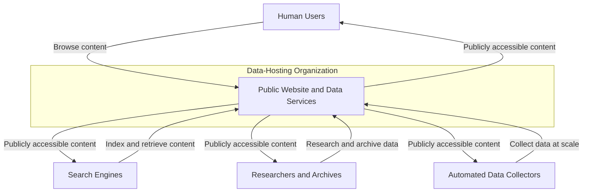
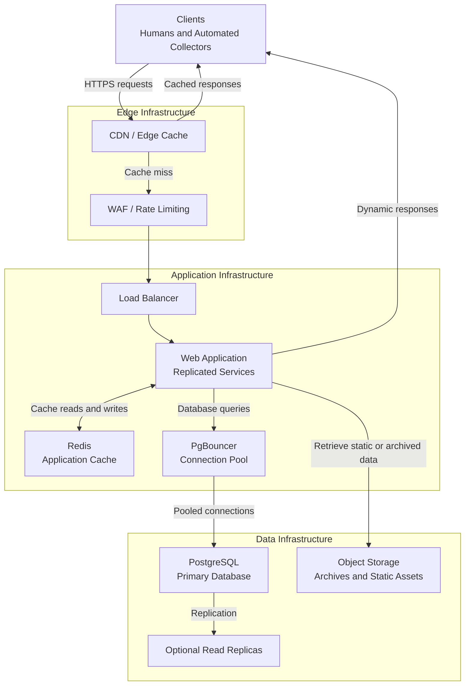
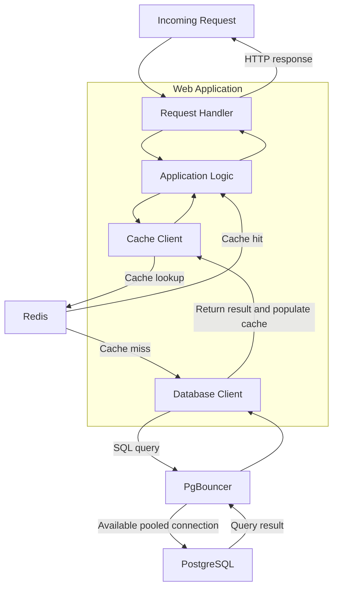
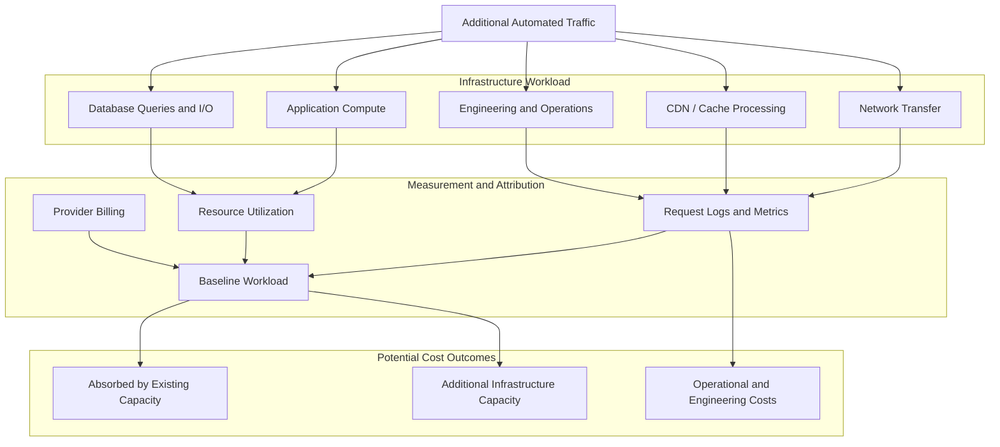

Earlier this year, I co-wrote a paper titled [“Beyond the Prompt: The Social Costs of Generative Artificial Intelligence”](/data/Beyond-the-Prompt-Social-Costs-of-Generative-AI.pdf). In this paper, we explored how generative artificial intelligence affects the digital commons (e.g., the internet), particularly the organizations and communities responsible for making information publicly available.

One of the topics we discussed was scraping and the costs imposed on organizations around the world.

But not all systems are created equal, and neither are the costs of operating them at scale.

In this post, I want to explore what those costs actually look like from an infrastructure perspective. More specifically, I want to walk through a few examples of how we can estimate the additional demand placed on modern, scalable architectures when automated systems begin collecting data at significant volumes.

I’m not talking about the cost of training a model or generating a response. I’m talking about the infrastructure required to serve the information those systems consume.

And someone has to pay for that infrastructure.

Before we get into it, an important disclaimer: I do not work at or have I ever worked for or been affiliated with any of these examples. I have no clue what their infrastructure looks like, and I will probably underestimate the complexity and skill needed to support their endeavors. Supporting these systems takes rock-star SREs, DevOps teams, architecture review boards, and the dedication to implement ADRs in a multinational organization. This is not easy, folks.

I’m also simplifying some of the engineering involved. Anyone who has operated distributed systems at scale knows that architecture decisions, reliability engineering, capacity planning, and keeping everything running are far more complicated than a few boxes and arrows.

With that out of the way, let’s get into it.

*Figure 1: Publicly accessible data services support a variety of consumers. Although their purposes differ, each consumer generates demand on the infrastructure responsible for serving that data.*

## LLM Costs

> I also want to stress that the cost of serving a request is not necessarily the same as the cost of serving an additional request.

I look at costs when it comes to LLMs probably differently than most. The first side is training and the second is inference (prompting). These happen at different stages and on different timelines in the lifecycle of a model. Imagine thousands of blade or rack servers running at 100% CPU and GPU 24/7 for months.

During the inference phase (prompting the model), we use the model via parameters. This also includes any third-party APIs invoked during the use of a model itself (think MCP, Tools, Skills, etc.). This equates to a traditional serving/service application like those defined by AWS. They run in data centers but are load balanced to distribute traffic, have uptime and downtime metrics, and are probably not all running at 100%, but close.

In this post, I’m going to focus on the bridge between these: scraping and data collection. Each side of the model lifecycle uses data collected in many different ways. For example, some data is retrieved via approved (official) APIs and may or may not have contractual relationships with the source of that data. Additionally, this data is also collected via non-standard approaches (e.g., downloading and parsing HTML content, reading data sources of OCR’d text, etc.).

A typical website usually has some JavaScript or another language that serves up data from recent blogs, content, ads, etc. When that data is loaded, it can be cached (usually short term) or retrieved and computed directly at request time.

This little example means there are costs for whoever is hosting and serving this content. This includes ingress network costs, reading data (disk reads and writes), execution (CPU time), and, if caching is involved, storage and/or memory costs as well.

Most of the time these costs are not noticeable (unless you didn’t expect them), since most personal blogs are not accessed millions or billions of times a day. But things change dramatically if you think in terms of billions or trillions of data points. Most organizations can estimate costs and understand trends via metrics and monitoring of resources (and costs), which helps.

But not all organizations are for-profit, and the internet was made for free and open information sharing (soapbox moment). What this means is that these costs grow and will compound negatively for organizations that did not ask for, agree to, or want these costs.

Imagine you are Wikipedia and you have an enormous corpus of data that is free and on the internet for all to consume. Your goal is to share knowledge and help humanity, but now you’re faced with gazillions of requests that you didn’t expect (or ask for). There are significant increases in resource costs just by hosting the same data because we (the Supreme Court and Congress) said it was okay to scrape data that you do not own (hint: read the [linked paper](/data/Beyond-the-Prompt-Social-Costs-of-Generative-AI.pdf)).

When you are an organization that keeps data forever (or even for years), you usually have different tiers of data storage: hot (cache or indexed queries), medium (backup tables), and cold (buckets, disk/tape storage, etc.). You do this because hot storage is lightning fast but comes with an increase in costs. Caching also helps here by storing trending, newsworthy, or new content so it’s lightning fast to load when a topic is requested. Caching allows that data to be served immediately without having to query the data source or database.

> When I talk about caching here, I’m not talking about in-memory caching. I’m talking about Redis and other in-memory data stores.

Caching is not cheap, and you can’t keep everything in cache all the time (you would be storing and holding in memory the same dataset as in your database/on-disk, and it would be really expensive). Typically, you would put items that will be retrieved the most for a set period of time. If there was a newsworthy event, a company would hold that data in cache for 24 hours or until the number of requests becomes insignificant. After that 24 hours, it would slowly expire on its own as it’s not being requested anymore. This truly helps cut costs by reducing SQL/database queries (which cost network latency and CPU cycles).

If the item is not in cache, then a query to the database must be done to retrieve that data and return it to the user’s browser or request. Once it is requested, the data is typically added to cache, but this depends on many variables and organization infrastructure specifics. When you have a few thousand or even millions of requests, Postgres with a Redis caching layer can handle them. When you need to support billions of requests, you need additional infrastructure to handle the request/response times needed to make your site fast (especially if there is a data pipeline involved).

Postgres can handle most of these requests, but when you have to maintain a fast query rate (e.g., 100,000 QPS), you need to use a pool of connections. For Postgres, I’ve used pgbouncer to handle bursts in Postgres connections from a service making queries. You do this because you are only allowed so many open connections to Postgres. Connection pooling allows multiple (thousands of) pods or services to reuse those connections without continually handling connection and disconnection overhead.

Again, this is a simple example, but it shows that there are many aspects of costs imposed by scraping data from an organization. Now let’s take this a step further and look at how we can actually calculate some of these costs.

## Let’s Talk Numbers

Let’s assume an organization receives an additional 50 million requests per day from automated data collection. For this example, we’ll assume the average response size is 100 KB.

That’s approximately 5 TB of data served per day, 150 TB per month, and 1.8 PB per year.

Let that sink in for a second. We’re not talking about training a model, running inference, or operating a GPU cluster. We’re talking about serving data that already exists.

Of course, this doesn’t mean the organization is paying for every byte transferred at the same rate. Pricing depends on the hosting provider, CDN configuration, network transfer allowances, and other infrastructure specifics. But it gives us a starting point for understanding the scale of the workload.

Now let’s introduce caching.

*Figure 2: A representative web architecture showing how requests move through edge caching, application services, Redis, and PostgreSQL. Cache placement determines which components process each request and where additional workload accumulates.*

If 90% of those requests are served from a cache, only 5 million requests per day reach the origin infrastructure. That’s a significant reduction in application and database workload.

However, those 50 million requests still need to be served. The cache itself consumes resources, and network transfer may still incur costs depending on where the content is served. Additionally, the traditional configuration for the cache TTL would change to handle both “normal” and increased traffic demand.

Caching reduces the work performed by certain components, but it doesn’t make the underlying demand disappear.

## What Happens When We Miss the Cache?

*Figure 3: An application-level cache miss can trigger additional database work. Connection pooling helps manage database connections, but the resulting query workload still consumes database resources.*

Let’s assume each of our 5 million daily origin requests generates two database queries.

That’s an additional 10 million queries per day, or 300 million over 30 days.

Does this mean we need another database cluster? Not necessarily.

The impact depends on the existing workload, query complexity, available capacity, and how efficiently the database handles those queries. If the system has sufficient headroom, it might absorb the additional demand without requiring more infrastructure at all.

But if the database is already operating near capacity, those queries could increase latency, CPU utilization, and connection contention.

This is where things get expensive.

An organization might need to optimize queries, increase database capacity (memory, storage, CPU, etc.), introduce read replicas, or make architectural changes to accommodate the workload. Each option comes with financial and operational trade-offs.

And this brings us back to the question: who pays for that additional capacity?

## Calculating the Actual Cost

We can estimate these costs by looking at the additional resources consumed and determining which translate into additional costs.

For example, network transfer costs can be estimated using the additional data served and the applicable provider pricing. Compute costs can be calculated if the workload requires additional application instances. Managed database and caching costs can be evaluated in the same way.

However, there’s an important distinction between resource consumption and incremental costs.

An increase in CPU utilization doesn’t automatically mean a higher bill. Likewise, additional database queries don’t necessarily increase costs proportionally.

If existing infrastructure can absorb the workload, the immediate financial impact might be minimal. If the workload pushes the system beyond its capacity, the organization may need to provision additional resources.

The costs can also be nonlinear. A relatively small increase in traffic might require no changes at all, while crossing a capacity threshold could require another application instance (think scaled pods) or a database upgrade.

*Figure 4: Automated traffic can increase network, compute, database, and operational demand. The resulting financial impact depends on existing capacity, resource utilization, infrastructure pricing, and the engineering work required to maintain service quality.*

To estimate the impact, I’d start with a few measurements:

* Additional requests and average response size
* Cache hit rate and origin request volume
* Database queries generated per request
* CPU, memory, and network utilization
* Infrastructure billing and capacity changes

We also need a baseline to understand what the infrastructure would have consumed without the additional workload. Request logs and other telemetry can help attribute traffic to automated clients, although identifying the precise source isn’t always straightforward.

Once we understand the workload, the architecture, and the applicable pricing, we can start estimating the incremental cost.

## Putting a Dollar Amount on It

Let’s take our example a step further and put some actual dollar amounts behind it.

Remember, we’re assuming an additional 50 million requests per day, with an average response size of 100 KB. That’s approximately 150 TB of additional data served over 30 days.

For simplicity, let’s assume our organization pays an effective rate of $0.05 per GB of data transferred to clients. This is a hypothetical blended rate, not a quote from any particular cloud provider. Actual pricing varies significantly depending on CDN agreements, bandwidth commitments, geographic distribution, and hosting arrangements.

At that rate:

**150,000 GB × $0.05 = $7,500 per month.**

That’s $90,000 annually, assuming 12 identical 30-day billing periods.

And we’re only talking about network transfer.

Now, remember our 90% cache hit rate? That means approximately 45 million requests per day are served by the edge cache, while the remaining 5 million reach our origin infrastructure.

Let’s assume those origin requests generate two PostgreSQL queries each. That’s another 300 million database queries over 30 days.

Does this mean our database bill increases because we executed 300 million additional queries? Not necessarily.

If we’re running PostgreSQL on infrastructure that already has sufficient capacity, we might not pay anything extra for those queries. We’re consuming additional CPU cycles, memory, and I/O, but that doesn’t automatically translate into an additional invoice.

However, imagine our database is already operating near its capacity limits. The additional workload increases query latency, causes connection contention, or pushes CPU utilization beyond what we’re comfortable operating at.

Now we have a decision to make.

We could optimize queries, introduce additional caching, increase database capacity, or add read replicas. Each option has different engineering and financial costs.

For this example, let’s assume the organization needs to provision the following additional resources:

| Infrastructure | Additional monthly cost |
| --- | ---: |
| Network transfer (150 TB at $0.05/GB) | $7,500 |
| Additional application compute | $600 |
| Increased caching capacity | $300 |
| Database capacity or read replica | $1,200 |
| **Total** | **$9,600** |

These are illustrative costs, not estimates of what Wikipedia or any other organization actually pays. They also assume that the additional resources are required specifically because of this workload and that we aren’t double-counting transfer charges already included in another service.

Under those assumptions, we’re looking at approximately $115,200 annually in additional infrastructure costs.

And that’s before we account for engineering time.

But here’s where I think things get interesting.

What happens if our organization already has enough application, cache, and database capacity to handle the additional traffic?

In that scenario, our additional infrastructure costs might be limited primarily to network transfer. Instead of $9,600 per month, we might only incur the $7,500 transfer charge.

What if our hosting agreement also includes sufficient unused bandwidth allowance to absorb that transfer?

Our immediate additional cloud bill could be close to zero.

Same 50 million requests per day. Same 150 TB of monthly data transfer. Very different financial outcomes.

Of course, unused capacity isn’t necessarily free in an economic sense. Consuming it reduces the headroom available for future traffic, potentially bringing forward the next infrastructure upgrade.

And the opposite can happen, too.

Imagine the organization is operating just below a capacity threshold. A relatively small increase in traffic might require another application instance, a larger database tier, or additional infrastructure that can’t be provisioned in small increments.

The resulting cost increase isn’t necessarily proportional to the increase in requests.

This is why I think it’s important to distinguish between resource consumption, incremental financial costs, and the operational consequences of additional demand.

We can measure the resources consumed by scraping. We can estimate the additional infrastructure required to support that workload. But calculating the actual financial impact requires understanding the system’s existing capacity, architecture, and billing model.

And for organizations operating public resources with limited funding, even a relatively modest increase in recurring infrastructure costs can matter.

## The Costs We Don’t Always See

Infrastructure bills are only part of the picture (I don’t work in or around COGS at all, so I’m sure I’m simplifying it).

An organization might also spend engineering time investigating unexpected traffic, optimizing database queries, adjusting caching policies, or responding to performance issues.

These activities have an opportunity cost, even when they don’t result in an additional cloud invoice.

Of course, not every performance issue can be attributed to scraping. But when unexpected demand forces engineers to spend time managing infrastructure instead of working on other priorities, that impact matters.

This can be especially significant for organizations operating with limited budgets and engineering resources.

## Bringing It Back to the Digital Commons

Automated data collection isn’t inherently bad. Search engines, researchers, archives, and countless other services depend on it. In many ways, these systems are part of what makes the internet useful.

The problem I’m interested in is what happens when the scale of that collection begins imposing costs on the organizations making the information available.

Publicly accessible information isn’t necessarily free to serve at scale.

Someone still pays for the network transfer, compute, storage, and operational work required to make that information available.

Sometimes the costs are negligible. Sometimes existing infrastructure absorbs the demand. And sometimes a relatively small change in workload pushes a system beyond a capacity threshold, requiring additional infrastructure, engineering time, or both.

That’s an important distinction.

We can’t simply multiply requests by a cloud provider’s pricing table and call it the actual cost. We need to understand the architecture, the baseline workload, the resources consumed, and what changed as a result of the additional demand.

But the fact that these costs are difficult to calculate doesn’t mean they don’t exist.

When we discuss the costs of generative AI, we tend to focus on training, inference, and the enormous computational resources required to operate models.

I think we’re missing part of this picture.

The organizations providing the information these systems depend on are part of that ecosystem, too. Some are businesses. Others are nonprofits, research institutions, archives, or communities that exist primarily to share knowledge.

They didn’t necessarily build their infrastructure to support industrial-scale data collection.

And they may not have the resources to absorb it.

If we’re going to have a meaningful conversation about the costs of generative AI, we need to look beyond the prompt.

We need to account for the infrastructure supporting the data, too.
